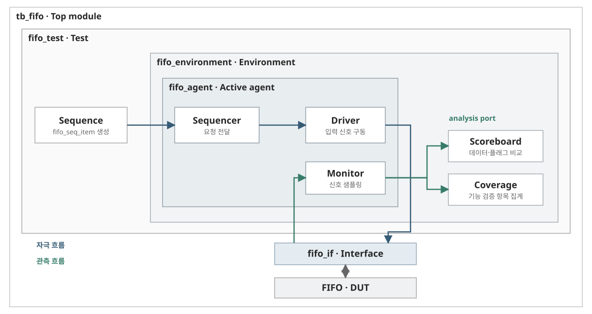
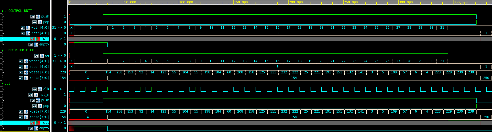
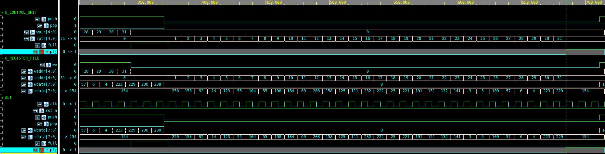

# FIFO — UVM Verification

8비트 데이터 FIFO의 push/pop, full/empty 경계, reset, 포인터 wrap 동작을 검증하는 UVM 프로젝트입니다. sequence → driver → DUT → monitor → scoreboard/coverage 흐름으로 구성합니다.



## 대표본

`rtl/fifo.sv`는 보관된 DUT이며 기본 `WIDTH=5`입니다. 내부 메모리 깊이는 32이고, full 판정/유효 용량은 원본 제어부 계약을 따릅니다. 내부 인스턴스가 WIDTH를 5로 고정하므로 임의 WIDTH 변경을 지원한다고 주장하지 않습니다.

`tb/tb_fifo_coverage.sv`를 기본 검증본으로 선택했습니다. 원본 `tb/baseline/tb_fifo.sv`와 비교해 directed·random sequence와 scoreboard를 유지하면서 점유 상태×연산, 데이터, 포인터 wrap, reset 상태 커버리지가 추가되어 있습니다. 두 TB는 같은 클래스·모듈 이름을 정의하므로 동시에 컴파일하지 않습니다.

## 검증 방법

- negedge clocking block으로 입력을 구동하고 posedge `input #1step`으로 관측합니다.
- scoreboard가 FIFO 상태와 읽기 데이터를 모델과 비교합니다.
- full 상태 push, empty 상태 pop, 동시 push/pop, reset과 랜덤 자극을 포함합니다.
- 커버리지는 실행 분포를 보여주는 보조 근거이며 오류 0과 같은 의미가 아닙니다.

## 실행

VCS + UVM 1.2가 구성된 Linux에서:

```sh
make sim SEED=1 PLI_FLAGS="<서버의 Verdi FSDB PLI 옵션>"
```

원본 TB는 FSDB 시스템 태스크를 사용하므로 VCS에서는 해당 PLI가 필요합니다.

Vivado XSim + UVM 환경의 Windows에서는:

```powershell
./scripts/run_xsim.ps1 -VivadoBin 'C:/Xilinx/Vivado/2020.2/bin' -Seed 1
```

XSim 스크립트는 FSDB 호출을 제거한 임시 TB를 `build/xsim/`에 만들고 원본 TB는 유지합니다. 최종 UVM_ERROR/FATAL 0과 커버리지 요약 존재를 확인합니다. 프로세스 종료만으로 FIFO 전 항목 합격을 선언하지 않습니다.

## 결과와 한계

다음 이미지는 발표 준비 때 보관한 과거 파형·로그 캡처입니다. 커버리지 확장 TB의 이번 실행 결과로 표시하지 않습니다.




이번 작업에서는 파일 목록·소스 해시·단일 TB 선택을 검사했습니다. 현재 장치에 VCS/Vivado 실행 환경이 확인되지 않아 커버리지 확장본의 새 시뮬레이션 및 수치 산출은 수행하지 않았습니다. 이 프로젝트의 수업 기반 DUT·UVM 구조와 개인 검증 작업은 구분해서 설명해야 합니다.
