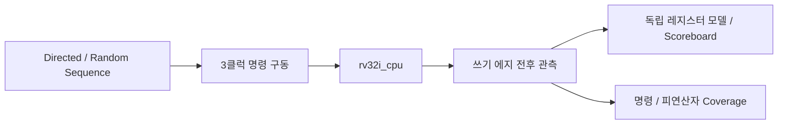
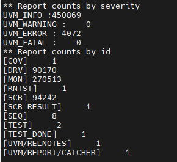
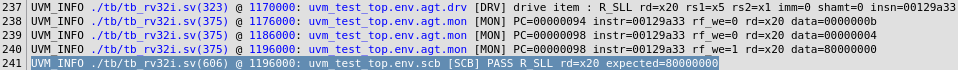
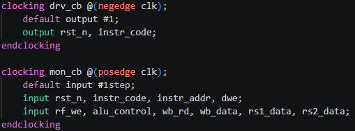

# RV32I CPU — R/I ALU UVM Verification

멀티사이클 RV32I CPU의 **R형 10개와 I형 ALU 9개**를 UVM으로 검증한 프로젝트입니다. 개인 담당은 해당 검증이며 팀 전체 CPU/APB 설계를 독자 작성한 것으로 표기하지 않습니다.

## 구조



고정 ROM으로 시스템 전체를 실행하는 방식 대신 CPU에 명령을 직접 공급하고 `drdata=0`으로 제한합니다. full RV32I ISA, load/store, JALR, APB·메모리 통합, FPGA 완료 검증과 범위를 구분합니다.

## 최종본 선정

아카이브 `최종결과물`의 `project_rv32i_cpu_from_mobaxterm` RTL/TB를 채택했습니다. 학습자료 `rv32i_cpu_uvm`와의 파일별 바이트 비교는 [source_comparison.json](docs/source_comparison.json)에 있습니다. 최종본은 shift 양의 `rs2[4:0]` 적용과 과거 VCS·XSim 재검증 기록이 연결됩니다. 기록·폴더 이름만으로 발표 당시 빌드 입력과 암호학적으로 완전히 동일하다고 단정하지 않습니다.

## 실행

VCS + UVM 1.2 Linux 환경:

```sh
make sim SEED=1 PLI_FLAGS="<서버의 Verdi FSDB PLI 옵션>"
```

Vivado XSim + UVM Windows 환경:

```powershell
./scripts/run_xsim.ps1 -VivadoBin 'C:/Xilinx/Vivado/2020.2/bin' -Seed 1
```

XSim용 임시 TB에서는 FSDB 호출만 제거하고 원본을 유지합니다. 스크립트는 UVM_ERROR/FATAL 0과 `CHECKED=90170 PASS=90170 FAIL=0`을 확인합니다. 원본 TB의 계층 probe와 3클럭 입력 계약에 종속되므로 CPU 구조를 바꾸면 TB도 검토해야 합니다.

## 결과와 문제 해결

| 기록 | 검사 결과 | 기능 커버리지 |
|---|---|---|
| 과거 VCS seed 1 | 90,170개, FAIL 0, UVM_ERROR/FATAL 0 | 99.56% |
| 2026-10-21 XSim 재검증 seed 1 | 90,170개, FAIL 0, UVM_ERROR/FATAL 0 | 99.49% |

수치는 보관된 [과거 발췌](docs/results/historical_result_excerpt.txt), [재검증 발췌](docs/results/new_result_excerpt.txt), [확인 결과](docs/results/validation.json)의 서로 다른 실행 결과입니다. 이번 GitHub 정리에서 재실행한 수치가 아닙니다.

R형 시프트의 `rs2` 전체 사용으로 이동량 32 이상에서 발생하는 오류를 분석하고 하위 5비트만 사용하는 동작과 비교했습니다. monitor의 clocking block 샘플링과 에지 이후 실제 레지스터 반영을 구분한 점도 핵심 설명 사례입니다.





## 한계

단일 seed·해당 명령 범위의 성공입니다. 비목적지 레지스터 오염, 불필요한 메모리 write, 중간 reset 등 checker 보완 여지가 있습니다. coverage 100%나 전체 CPU 적합성을 주장하지 않습니다. 99.56%와 99.49%는 도구·실행 차이가 있는 각각의 기록입니다. 이번 작업은 원본 해시·실행 입력·문서 링크를 확인했으며 새 UVM 실행은 수행하지 않았습니다.
