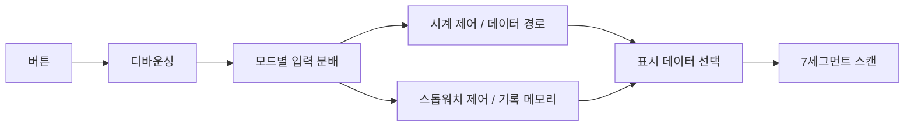

# Stopwatch & Watch — RTL Design

Basys 3에서 시계·스톱워치를 선택하고 버튼으로 동작을 제어하는 Verilog 프로젝트입니다. 스톱워치 실행/정지·기록, 시계 시간 편집, 표시 선택을 공통 7세그먼트 출력으로 연결합니다.

## 구조



대표 Top은 `rtl/top_module_sw_w.v`의 `top_module_sw_w`입니다. `sw[1]`로 시계/스톱워치를 선택하고 입력 분배기·표시 선택기가 두 경로를 연결합니다. `sw[0]`, `sw[2]`와 버튼의 세부 동작은 각 제어부 소스를 기준으로 확인합니다.

## 소스 선정

학습자료의 7월 28일 `top_stopwatch` 단독 구성보다 통합 Top이 있는 `2026_07_31_stopwatch_watch` 보관본을 대표본으로 선택했습니다. XPR에 등록된 RTL 7개, TB, 원본 XDC를 보존했습니다. 폴더 날짜를 개발 종료일로 단정하지 않습니다.

| 위치 | 내용 |
|---|---|
| `rtl/` | 통합 Top, 시계·스톱워치, 제어부, 디바운싱, FND |
| `tb/` | 원본 시뮬레이션 입력; 일부 TB는 XPR에서 자동 제외된 과거 검사본 |
| `constraints/` | 보관본의 Basys 3 핀·클럭 제약 |
| `docs/reports/` | 과거 배치·배선 타이밍 및 자원 사용 보고서 |

## 실행

Vivado와 Basys 3의 Artix-7 `xc7a35tcpg236-1` 환경을 사용합니다. 이 폴더에서:

```sh
vivado -mode batch -source scripts/create_project.tcl -tclargs stopwatch_watch synth
```

`build/stopwatch_watch/`에 프로젝트를 생성합니다. 단순 프로젝트 생성은 마지막 `synth`를 생략합니다. 재실행은 기존 생성 폴더와 다른 새 작업 경로에서 수행하세요. 시뮬레이션 Top은 목적에 맞게 `tb_top_module_sw_w` 또는 `tb_btn_debounce`를 선택합니다. 자극 중심 TB이며 자동 합격 판정이 갖춰졌다고 보장하지 않습니다.

## 결과와 한계

보관된 2026-08-13 Vivado 2020.2 보고서에서 WNS **5.531 ns**, TNS **0 ns**와 사용자 지정 타이밍 제약 충족 문구를 확인했습니다. 동시에 `no_clock 35`, `unconstrained_internal_endpoints 70`, 입출력 delay 누락이 기록되어 있습니다. 이를 모든 경로의 타이밍 검증 완료로 해석하지 않습니다. 과거 실행 시점의 서명된 소스 manifest가 없으므로 현재 소스와 그 실행의 완전한 동일성은 보장하지 않습니다.

이번에는 RTL·TB·XDC 해시와 입력 경로를 확인했습니다. 새 합성·보드 실행은 수행하지 않았습니다. 팀/수업 원본 기반 설계이므로 개인 담당의 세부 범위는 발표자료를 함께 참고해야 합니다.
