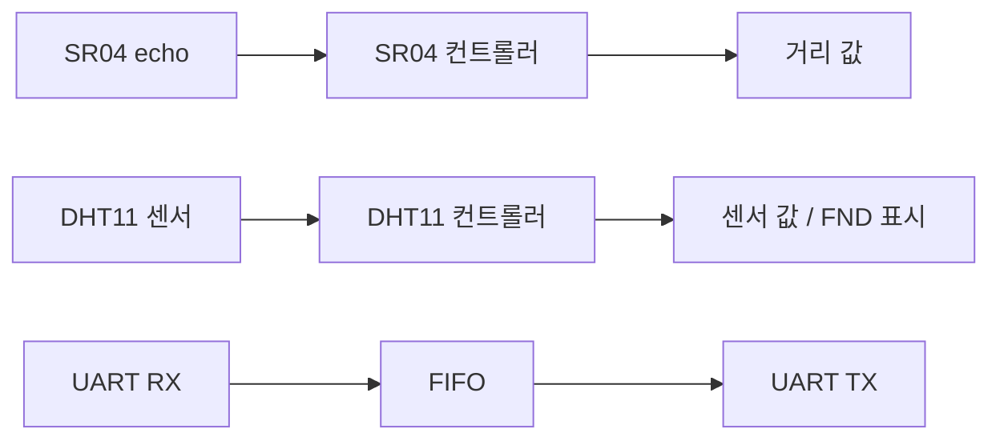

# UART / DHT11 / SR04 — Team Project

DHT11 온습도·SR04 초음파 센서 제어, UART 송수신·FIFO, 시계/스톱워치를 다룬 팀 프로젝트 자료입니다. 보존 소스에서 실행 가능한 단위를 구분해 구성했습니다.

## 구조와 범위



위는 각 하위 설계의 흐름입니다. 센서 출력이 UART/FIFO에 연결된 최상위 모듈의 확보·검증을 의미하지 않습니다.

| 대상 | 소스 / Top | 보관 상태 |
|---|---|---|
| DHT11 | `rtl/dht11/` / `TOP_DHT11` | 원본 센서 설계와 TB·XDC |
| SR04 | `rtl/sr04/` / `lec_sr04_controller` | ILA 의존성이 없는 보관 컨트롤러; 독립 TB·핀 제약 미확보 |
| UART FIFO | `rtl/uart_fifo/` / `uart_fifo_loopback` | 원본 UART·FIFO loopback과 TB; 이 보관본에는 XDC 없음 |
| 팀 보존본 | `rtl/team_snapshot/` | 8월 14일 프로젝트의 SENSOR·UART·시계 소스 |
| 팀 보존 시계 Top | `rtl/team_snapshot/stopwatch_watch/` / `top_module_sw_w` | XPR의 활성 Top; 센서·UART를 통합 연결하지 않음 |

## 선정 이유

팀 폴더 이름만 보고 전체 시스템 최종본으로 묶지 않았습니다. 원본 XPR의 Top은 `top_module_sw_w`이며 UART 파일은 AutoDisabled였습니다. 센서 파일의 일부에는 별도 ILA IP 의존성도 있습니다. 독립 DHT11·UART FIFO 학습자료는 파일 목록과 과거 합성 확인 근거가 있어 대표 실행 단위로 선택했습니다. 동명 모듈이 있으므로 하위 설계 전체를 한꺼번에 컴파일하지 않습니다.

## 실행

Vivado에서 이 폴더를 기준으로 대상 하나를 선택합니다.

```sh
vivado -mode batch -source scripts/create_project.tcl -tclargs dht11 synth
vivado -mode batch -source scripts/create_project.tcl -tclargs uart_fifo synth
vivado -mode batch -source scripts/create_project.tcl -tclargs sr04 synth
vivado -mode batch -source scripts/create_project.tcl -tclargs team_watch synth
```

각 대상은 `build/<target>/`에 따로 생성됩니다. 같은 대상 재생성은 새 작업 폴더를 사용하세요. `sr04`는 `SENSOR/SR04.v`의 ILA 의존 Top 대신 `lec_sr04_controller.v`를 따로 선택했습니다. SR04의 새 합성·기능 검증은 수행하지 않았습니다. `uart_fifo`·`sr04`의 보드 구현에는 해당 보드의 검토된 핀 제약을 별도로 준비해야 합니다. 다른 실습 XDC를 임의로 적용하지 않았습니다.

## 검증 근거와 한계

아카이브의 DHT11·UART FIFO 안내에는 2026-10-29 Vivado 2020.2 합성 완료 및 black box 없음이 기록되어 있습니다. 해당 기록은 기능 시뮬레이션, 타이밍 충족, 실제 보드 시연 성공을 모두 증명하지 않습니다. 이번에는 소스 원본 보존·파일 의존성·빌드 대상 구분을 확인했습니다.

이 자료는 김민석·손승원 팀 발표와 연결됩니다. 팀 전체 구현을 개인 독자 성과로 표기하지 않습니다. 전체 센서→UART 통합 완료 소스는 현재 선별 자료만으로 확정하지 않았으며 이를 새로 만들어 최종 원본으로 표시하지 않았습니다.
